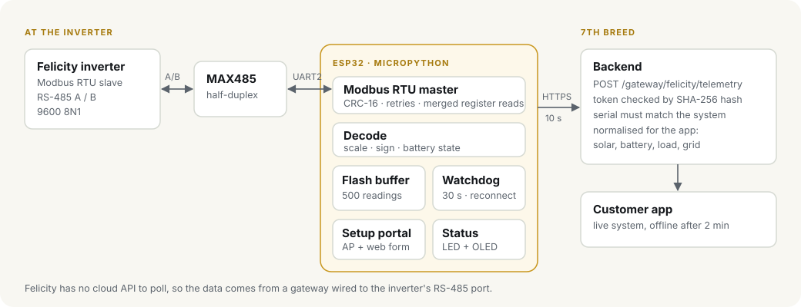
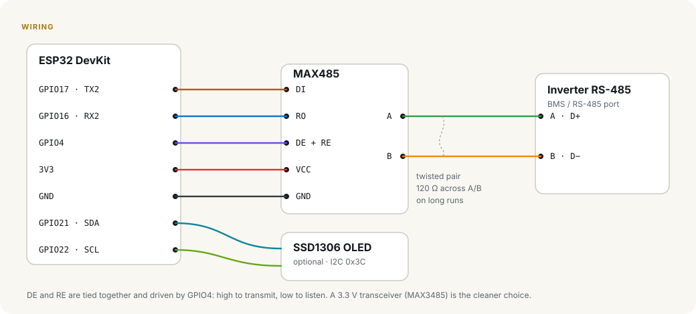

# Felicity Gateway

An ESP32 edge gateway that reads a Felicity Solar inverter over RS-485 (Modbus RTU) and streams its live data to the 7th Breed backend, so customers can watch their solar system from the 7th Breed app.

I built it at 7th Breed to prove the backend's local-gateway path end to end: inverter → ESP32 → HTTPS → `POST /api/auth/monitor/gateway/felicity/telemetry` → the customer's live monitoring screen. Felicity inverters don't have a cloud API the backend can poll the way Victron or Deye do, so the data has to come from a device sitting next to the inverter.

Written in MicroPython.



## What it does

- **Modbus RTU master** on UART2 through a MAX485 transceiver, with CRC checks, exception handling, retries, and nearby registers merged into as few requests as possible.
- **Telemetry**: battery voltage, current, power, state of charge and state; PV power; grid and load power; fault and warning codes. Scaling and signed values are handled by a single register table in `src/registers.py`.
- **Backend contract**: each reading is posted with the gateway token in the `x-7th-breed-gateway-token` header and the inverter serial as `deviceId`. The backend only accepts it if the token's hash matches a registered system and the serial matches that system.
- **Offline buffering**: if Wi-Fi or the backend is down, readings are kept on flash (up to 500, oldest dropped first). The backlog is sent in order before the current reading, so the newest value is always the one the app shows.
- **Watchdog and reconnect**: a 30 s hardware watchdog, Wi-Fi reconnects on every cycle, and a full restart if the network stays down for 10 minutes.
- **Setup portal**: on first boot, or when the BOOT button is held at power-up, the gateway opens a Wi-Fi network (`7B-Gateway-XXXX`) with a form for the Wi-Fi details, gateway token, inverter serial and send interval.
- **Status**: the on-board LED blinks a different pattern for each state, and an optional SSD1306 OLED shows SOC, battery voltage, PV power, load and the size of the offline queue.
- **Bad config is not retried forever**: a 401, 409 or 422 from the backend means the token or serial is wrong, so the gateway flags it on the LED instead of filling the buffer.

## Hardware

| Part | Notes |
|---|---|
| ESP32 dev board | Any ESP32-WROOM DevKit |
| MAX485 module | 5 V modules work with the ESP32's 3.3 V UART at 9600 baud; a 3.3 V part (MAX3485) is the cleaner choice |
| SSD1306 128×64 OLED | Optional, I2C |
| 12/24/48 V → 5 V buck converter | To power the gateway from the battery bank, or use USB |

### Wiring



| ESP32 | MAX485 | Inverter RS-485 port |
|---|---|---|
| GPIO17 (TX2) | DI | |
| GPIO16 (RX2) | RO | |
| GPIO4 | DE and RE (tied together) | |
| 3V3 / 5V | VCC | |
| GND | GND | GND (if the port has one) |
| | A | A / D+ |
| | B | B / D− |

OLED: SDA → GPIO21, SCL → GPIO22. Status LED: GPIO2 (on-board). Setup button: GPIO0 (BOOT).

Keep the A/B pair twisted, and fit a 120 Ω termination across A and B at the far end on long runs.

## Install

1. Flash MicroPython onto the ESP32.
2. Copy the firmware over (add `ssd1306.py` from micropython-lib if you are using the OLED):

   ```
   mpremote cp src/*.py :
   mpremote reset
   ```

3. Join the `7B-Gateway-XXXX` Wi-Fi (password `7thbreed-setup`), open `http://192.168.4.1` and fill in the form. The gateway token comes from the 7th Breed backend (`POST /api/auth/monitor/systems/:id/gateway-token`) and is shown only once.

### Register map

The addresses in `src/registers.py` must match the Modbus protocol document for your inverter model and firmware. Felicity's register layout is not the same across its range, so check them before you deploy.

## Status LED

| Pattern | Meaning |
|---|---|
| Fast, even blink | Setup portal is open |
| Long on, long off | No Wi-Fi or backend unreachable; readings are being buffered |
| Two short blinks | No reply from the inverter (check A/B wiring, baud rate, slave ID) |
| Three short blinks | Backend rejected the reading (wrong token or serial) |
| Short flash every 3 s | Running normally |

## Tests

The protocol, decoding, buffering, form parsing and uplink logic are kept free of hardware imports, so they run on a PC:

```
python -m unittest discover -s tests -v
```

## Layout

```
src/
  main.py       main loop: read, send, buffer, watchdog
  modbus.py     RTU framing, CRC-16, response parsing
  rtu.py        RS-485 half-duplex master on a UART
  registers.py  register map and request planning
  telemetry.py  raw registers → named values → backend payload
  uplink.py     HTTPS post with the gateway token
  buffer.py     flash-backed offline queue
  portal.py     Wi-Fi setup portal
  forms.py      form decoding for the portal
  config.py     settings stored on flash
  status.py     LED patterns and OLED
tests/
  test_gateway.py
```

## License

MIT
